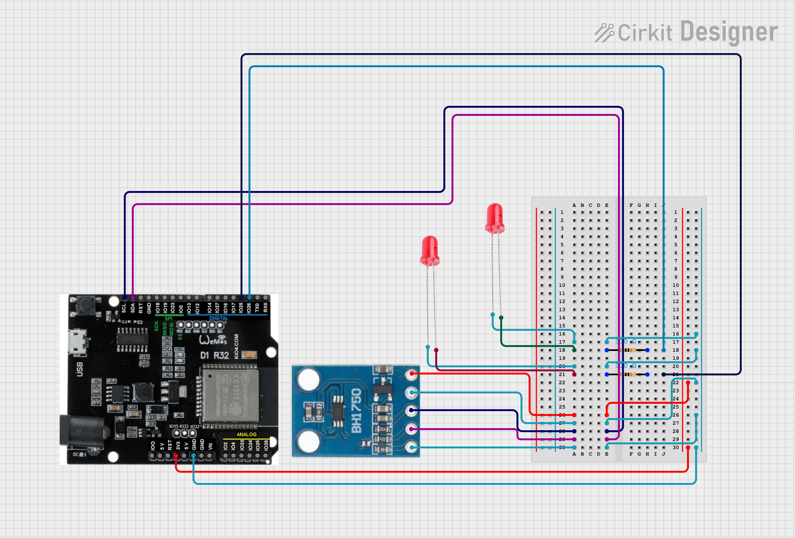

# Light Switching According to Intensity

Embedded system for the ESP32 that measures ambient light intensity with a BH1750 sensor and automatically controls the brightness of LEDs: the darker the surroundings, the brighter the LEDs shine. Measured values are published over MQTT and displayed in a simple web interface.

Project for the IMP course (Microprocessors and Embedded Systems) at FIT BUT.

**Video presentation (in Czech):** https://youtu.be/wNy5hLKIjT0?si=vPR_rue0_GSCVC_1

Full documentation: [imp_doc.pdf](imp_doc.pdf)

## Features

- Light measurement in lux using the BH1750 sensor over I2C
- PWM control of two LEDs, inversely proportional to the ambient light
- Gamma correction for smooth, natural-looking brightness transitions
- Hysteresis (counting consecutive measurements) to prevent flickering near the thresholds
- Configuration over the serial line (UART), persisted in non-volatile memory (NVS)
- Publishing of measured data in JSON over MQTT via Wi-Fi
- Web interface (nginx + Mosquitto in Docker) showing the measurements and current configuration
- If serial, Wi-Fi or MQTT initialization fails, the device keeps running without that service

## Hardware

| Component     | ESP32 pin |
|---------------|-----------|
| BH1750 SDA    | GPIO 21   |
| BH1750 SCL    | GPIO 22   |
| LED 1         | GPIO 25   |
| LED 2         | GPIO 26   |



## Project Structure

```
.
├── CMakeLists.txt        # ESP-IDF project definition
├── Makefile              # shortcuts for build / flash / web / pack
├── imp_doc.pdf           # documentation
├── docs/                 # wiring scheme and references
├── src/
│   ├── main.c            # initialization and main loop
│   ├── led/              # PWM, hysteresis, gamma correction
│   ├── sensor/           # BH1750 over I2C
│   ├── nonvolatile/      # user configuration in NVS
│   ├── mqtt_wifi/        # Wi-Fi station + MQTT client
│   ├── serial/           # UART command interface
│   └── types/constants.h # all configuration constants
└── web/
    ├── docker-compose.yml
    ├── mosquitto/        # MQTT broker config
    └── web/index.html    # web interface
```

## Requirements

- Linux
- [ESP-IDF](https://docs.espressif.com/projects/esp-idf/) installed in `$(HOME)/esp/esp-idf` (otherwise change `IDF_PATH` in the `Makefile`)
- Docker with Docker Compose (for the web interface and MQTT broker)

## Configuration

Before building, set your network parameters near the end of [src/types/constants.h](src/types/constants.h):

```c
#define WIFI_SSID        "imp-wifi"
#define WIFI_PASSWORD    "imp-wifi"
#define MQTT_URI         "mqtt://1.1.1.1:1883"   // IP of the machine running Docker
```

The port `1883` must stay the same. The ESP32 and the computer running the broker must be on the same **2.4 GHz** Wi-Fi network.

## Usage

```sh
make build      # build the project
make run        # build, flash to the ESP32 and open the serial monitor
make web        # start the MQTT broker and web interface (Docker)
make web_down   # stop and remove the containers
make clean      # remove build artifacts
make pack       # create a zip archive of the project
```

After `make web`, open http://127.0.0.1:8080 in a browser.

### Serial commands

| Command                 | Description                              |
|-------------------------|------------------------------------------|
| `set tmin <value>`      | minimum light threshold (lux)            |
| `set tmax <value>`      | maximum light threshold (lux)            |
| `set debounce <value>`  | number of measurements for hysteresis (min. 4) |
| `set time <value>`      | measurement period in ms (min. 200)      |
| `show`                  | show the current configuration           |
| `help`                  | print help                               |

## References

See [docs/references.txt](docs/references.txt).

## Author

Martin Zůbek
